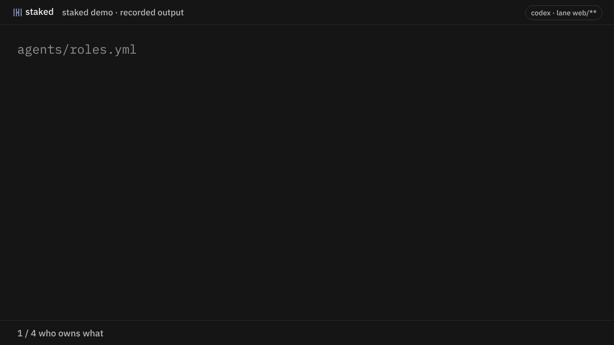

<p align="center">
  <picture>
    <source media="(prefers-color-scheme: dark)" srcset="docs/brand/reveal-on-dark.gif">
    
  </picture>
</p>
<p align="center"><b>Give each coding agent its own part of the repo.</b></p>
<p align="center">Each agent gets its own lane. You get one short list of what needs you.<br>Plain files in your repo. No server, no account.</p>

**staked is a free, open-source command-line tool for running several AI coding agents (Claude Code, Codex, Cursor, Gemini CLI) on one Git repository.** You assign each agent the paths it owns in one file. staked writes each agent's instruction file, checks staged files before every commit, and keeps one short list of decisions waiting for you.

<p align="center"></p>
<p align="center"><sub>Recorded from a real run.</sub></p>

---

## Get started

```sh
npm i -D @zerwone/staked
npx @zerwone/staked init --agents claude-code=src/**,codex=web/**
```

That one command:

1. writes `agents/roles.yml`: who owns which folders
2. writes a short `CLAUDE.md` and `AGENTS.md` for each agent, so they know their lane and their tasks
3. installs a git hook that checks staged files and refuses a commit outside the agent's lane

The hook is a workflow check, not a sandbox: an agent can still edit any file, and `git commit --no-verify` skips it (reviews will see that).

Then tell each agent who it is, once per worktree: `git config user.name codex`. They pick it up from there.


## What you'll see

An agent tries to commit a file outside its lane:

```
staked check: refused for codex
  - src/api/orders.ts: outside codex's lane (lane of claude-code)
```

An agent needs a decision from you. It asks, picks a safe default, and keeps working. From your phone:

```
$ npx @zerwone/staked questions open
Q-001 · blocks 1: T-012 · codex · 0m · exp 11-09
  Same page or separate tab for order history? → default: same page
```

Answer it, or let the default stand.

## Commands you'll actually use

| | |
| --- | --- |
| `staked questions open` | what needs you, most urgent first |
| `staked board` | who is doing what right now |
| `staked handover codex claude-code` | move a lane or the boss role, one command |
| `staked doctor` | something feels off? start here |

Agents use `claim`, `status` and `ask`; their `CLAUDE.md` tells them how. Full list and file formats: [docs/REFERENCE.md](docs/REFERENCE.md)

## Why it exists

staked comes from a real project: 4 agents (Claude Code, Codex, Cursor), 24 days, about 1,600 commits, coordinated with hand-written markdown. It worked, but the files didn't scale:

| | by hand | with staked |
| --- | --- | --- |
| coordination files each agent was pointed at | ~300 KB | 2.6 KB generated per agent (measured on this repo) |
| finding what needs you | 256 KB of board and questions | one short list |
| commits that touched two agents' lanes at once | 29, none flagged | the hook refuses this kind of commit (tested on sample commits, not yet replayed on the original 29) |

The full audit: [docs/ORIGIN.md](docs/ORIGIN.md)

## FAQ

**How do I run multiple coding agents on the same repo without conflicts?**
Two layers. Git worktrees give each agent its own working copy, so they don't overwrite each other's files while they work. staked decides who may change which paths and checks it before each commit, so work stays in its lane when it comes back together. Use both.

**What's the difference between staked and git worktrees?**
Worktrees separate where agents work. staked separates what they may change, writes their instructions, and collects their questions. Worktrees alone don't stop two agents from editing the same module on different branches.

**How is it different from CODEOWNERS?**
CODEOWNERS requests reviewers on a pull request after the change exists. staked checks each agent's commit locally, before it exists, and also gives each agent its own instructions and a place to ask you questions.

**Does it work with Claude Code, Codex, Cursor and Gemini CLI?**
Yes. It generates `CLAUDE.md`, `AGENTS.md`, `.cursor/rules/staked.mdc` and `GEMINI.md`, the files those agents already read. Any agent that reads files in the repo can follow it.

**Can it stop an agent from editing a file?**
No. It refuses the commit, not the edit. It is a workflow check, not a sandbox, and `git commit --no-verify` skips it.

**Does staked call an AI model or need a server?**
No. It is plain files in your repo, a CLI and a Git hook. No account, no network calls.

## Works with

Any agent that reads a file in the repo: **Claude Code**, **Codex**, **Cursor**, **Gemini CLI**. Windows, macOS, Linux.

---

Built by Mohamad Aljadaan at **ZerwOne**.

MIT · [Contributing](docs/DEVELOPMENT.md) · Sister project: **pocket**, moves your agent to your next key when its model hits a usage limit
